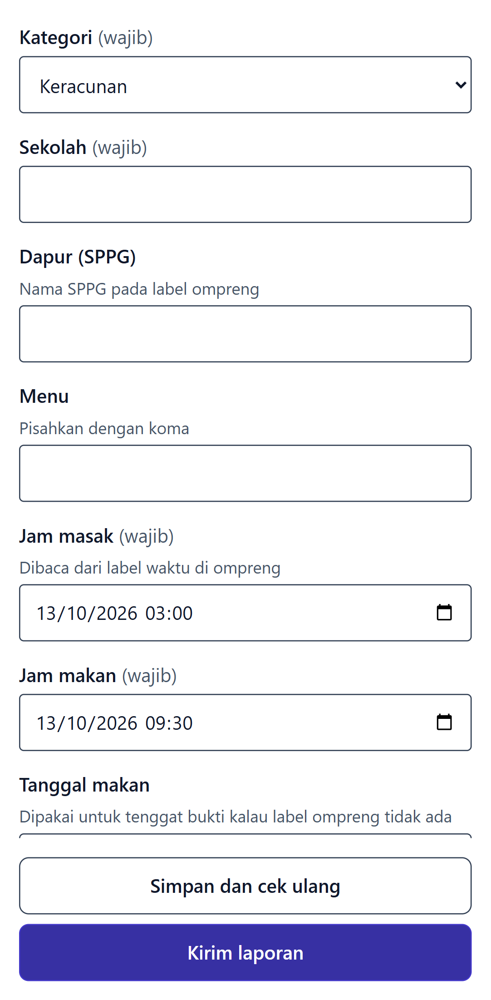
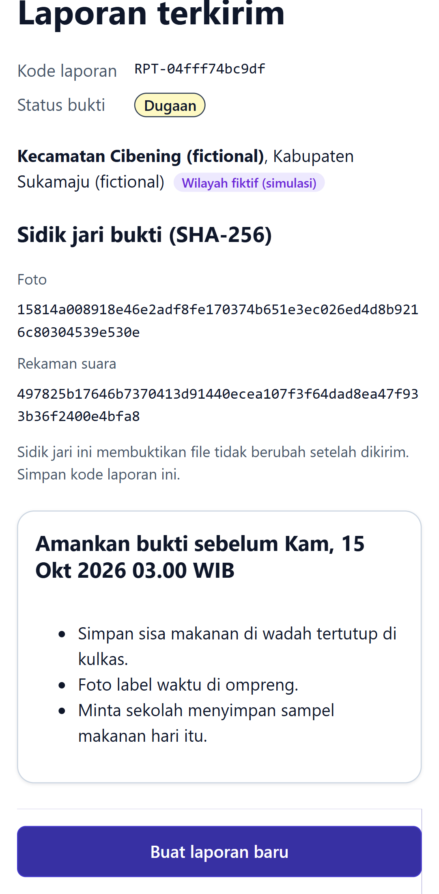

# E2E evidence: issue #28

Feature issue: https://github.com/yusronMu77/agesoa-prototype/issues/28  
Tested commit: `agesoa-prototype@a1809c00bfce`, test suite `agesoa-e2e@2099b51f6953`  
Run: 2026-10-13 10:49 +07:00. All test cases below passed; files are the screenshots/videos recorded by Playwright.

| Test case | Test | Project | Result | Duration |
|---|---|---|---|---|
| TC-001 | tests\e2e\witness\report.spec.ts > Anonymous report with photo, voice note and location produces a draft @p0 @smoke @TC-001 | e2e-witness | passed | 14.1 s |
| TC-002 | tests\api\ingestion\reports.spec.ts > corrections with unknown fields or wrong types are refused @p0 @TC-002 | api-ingestion | passed | 1.2 s |
| TC-002 | tests\e2e\witness\report.spec.ts > Correct a field, submit, and verify stored value and evidence hash @p0 @smoke @TC-002 | e2e-witness | passed | 10.2 s |
| TC-029 | tests\api\ingestion\reports.spec.ts > instructions inside a report are data: rules and statuses do not change @p0 @TC-029 | api-ingestion | passed | 1.4 s |
| TC-029 | tests\api\ingestion\reports.spec.ts > a report without a category cannot be submitted @p0 @TC-029 | api-ingestion | passed | 0.7 s |

## TC-001

- [TC-001-e2e-witness-2.webm](TC-001-e2e-witness-2.webm)

## TC-002

- [TC-002-e2e-witness-2.webm](TC-002-e2e-witness-2.webm)
