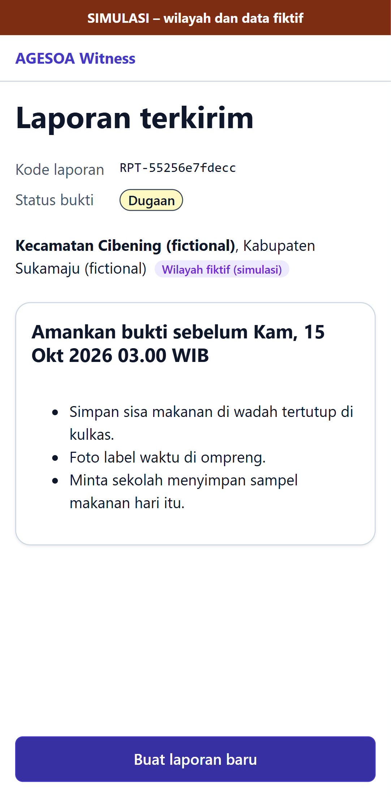

# E2E evidence: issue #29

Feature issue: https://github.com/yusronMu77/agesoa-prototype/issues/29  
Tested commit: `agesoa-prototype@a1809c00bfce`, test suite `agesoa-e2e@2099b51f6953`  
Run: 2026-10-13 10:49 +07:00. All test cases below passed; files are the screenshots/videos recorded by Playwright.

| Test case | Test | Project | Result | Duration |
|---|---|---|---|---|
| TC-003 | tests\api\ingestion\reports.spec.ts > evidence and reports are visible only to the reporting device @p0 @TC-003 | api-ingestion | passed | 0.9 s |
| TC-003 | tests\api\ingestion\reports.spec.ts > report endpoints need the anonymous device token @p0 @TC-003 | api-ingestion | passed | 0.3 s |
| TC-003 | tests\e2e\witness\report.spec.ts > No identity is requested or sent @p0 @TC-003 | e2e-witness | passed | 7.6 s |
| TC-004 | tests\api\ingestion\reports.spec.ts > photo is stored without EXIF/GPS and its hash is of the stored file @p0 @TC-004 | api-ingestion | passed | 0.8 s |
| TC-004 | tests\api\ingestion\reports.spec.ts > files that are not images or audio are refused, by content not by declared type @p0 @TC-004 | api-ingestion | passed | 0.7 s |

## TC-003

- [TC-003-e2e-witness-2.webm](TC-003-e2e-witness-2.webm)
