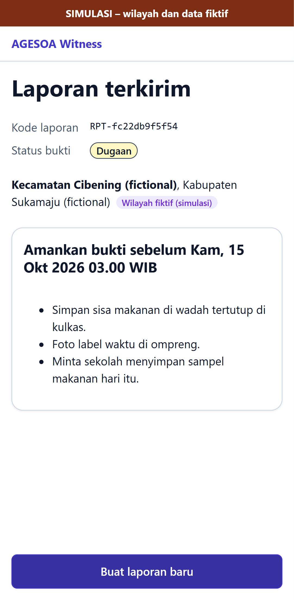

# E2E evidence: issue #30

Feature issue: https://github.com/yusronMu77/agesoa-prototype/issues/30  
Tested commit: `agesoa-prototype@a1809c00bfce`, test suite `agesoa-e2e@2099b51f6953`  
Run: 2026-10-13 10:49 +07:00. All test cases below passed; files are the screenshots/videos recorded by Playwright.

| Test case | Test | Project | Result | Duration |
|---|---|---|---|---|
| TC-005 | tests\api\ingestion\reports.spec.ts > approximate location becomes a district; coordinates are not returned @p0 @TC-005 | api-ingestion | passed | 0.4 s |
| TC-005 | tests\e2e\witness\report.spec.ts > Location is sent and shown only as a district @p0 @TC-005 | e2e-witness | passed | 6.1 s |

## TC-005

- [TC-005-e2e-witness-2.webm](TC-005-e2e-witness-2.webm)
