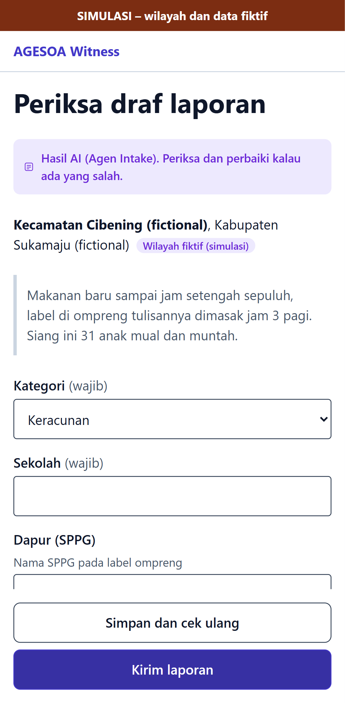
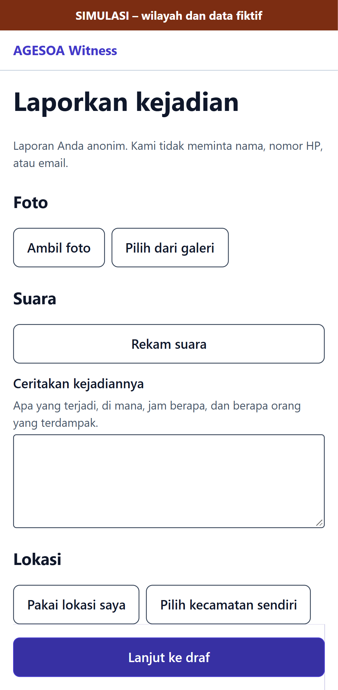

# E2E evidence: issue #31

Feature issue: https://github.com/yusronMu77/agesoa-prototype/issues/31  
Tested commit: `agesoa-prototype@a1809c00bfce`, test suite `agesoa-e2e@2099b51f6953`  
Run: 2026-10-13 10:49 +07:00. All test cases below passed; files are the screenshots/videos recorded by Playwright.

| Test case | Test | Project | Result | Duration |
|---|---|---|---|---|
| TC-008 | tests\api\ingestion\reports.spec.ts > a pasted text that is not a link is refused @p0 @TC-008 | api-ingestion | passed | 0.5 s |
| TC-008 | tests\e2e\witness\report.spec.ts > Shared social post link: validation and canonicalisation @p0 @TC-008 | e2e-witness | passed | 7.2 s |
| TC-008 | tests\e2e\witness\report.spec.ts > Shared social post: Kembali without saving attaches nothing @p0 @TC-008 | e2e-witness | passed | 3.1 s |
| TC-009 | tests\api\ingestion\reports.spec.ts > reposts of one post become one shared post, stored without the username @p0 @TC-009 | api-ingestion | passed | 0.6 s |

## TC-008

- [TC-008-e2e-witness-2.webm](TC-008-e2e-witness-2.webm)

- [TC-008-e2e-witness-4.webm](TC-008-e2e-witness-4.webm)
