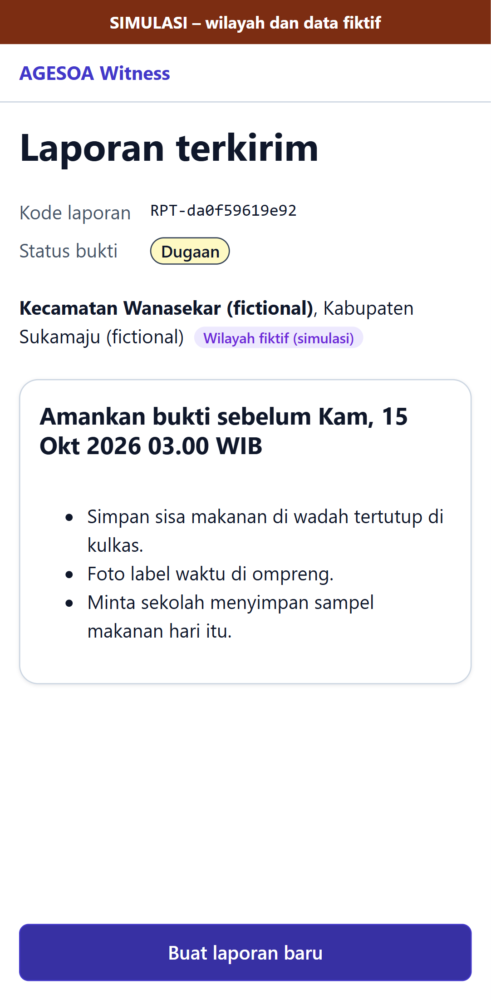
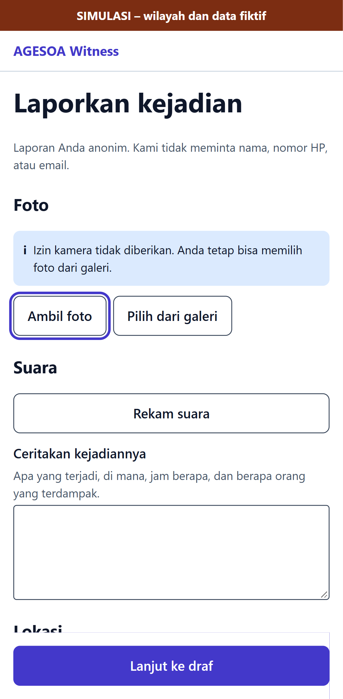
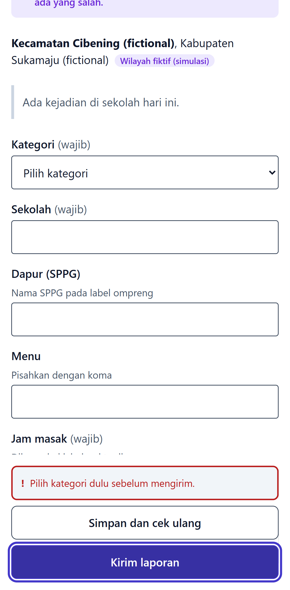

# E2E evidence: issue #46

Feature issue: https://github.com/yusronMu77/agesoa-prototype/issues/46  
Tested commit: `agesoa-prototype@a1809c00bfce`, test suite `agesoa-e2e@2099b51f6953`  
Run: 2026-10-13 10:49 +07:00. All test cases below passed; files are the screenshots/videos recorded by Playwright.

| Test case | Test | Project | Result | Duration |
|---|---|---|---|---|
| TC-001 | tests\e2e\witness\report.spec.ts > Anonymous report with photo, voice note and location produces a draft @p0 @smoke @TC-001 | e2e-witness | passed | 14.1 s |
| TC-006 | tests\api\ingestion\reports.spec.ts > a position outside every district asks for a manual pick @p0 @TC-006 | api-ingestion | passed | 0.9 s |
| TC-006 | tests\e2e\witness\report.spec.ts > Permissions denied: manual district fallback and report still sent @p0 @TC-006 | e2e-witness | passed | 7.2 s |
| TC-006 | tests\e2e\witness\report.spec.ts > Camera explainer: Tidak sekarang path @p0 @TC-006 | e2e-witness | passed | 3.7 s |
| TC-006 | tests\e2e\witness\report.spec.ts > Empty submission validation @p1 @TC-006 | e2e-witness | passed | 4.9 s |

## TC-001

- [TC-001-e2e-witness-2.webm](TC-001-e2e-witness-2.webm)

## TC-006

- [TC-006-e2e-witness-2.webm](TC-006-e2e-witness-2.webm)

- [TC-006-e2e-witness-4.webm](TC-006-e2e-witness-4.webm)

- [TC-006-e2e-witness-6.webm](TC-006-e2e-witness-6.webm)
