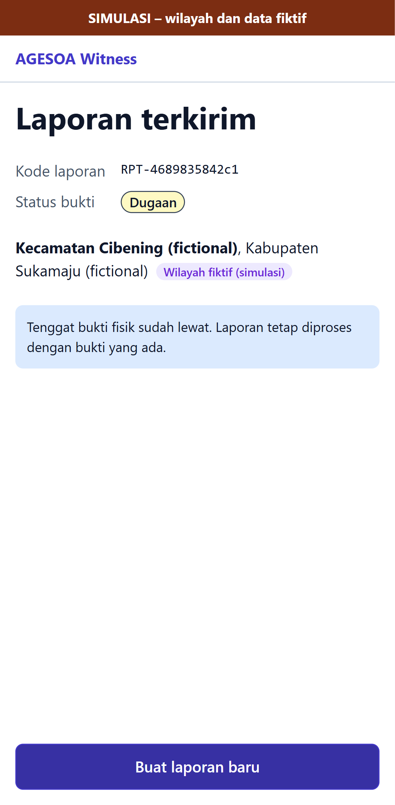

# E2E evidence: issue #47

Feature issue: https://github.com/yusronMu77/agesoa-prototype/issues/47  
Tested commit: `agesoa-prototype@a1809c00bfce`, test suite `agesoa-e2e@2099b51f6953`  
Run: 2026-10-13 10:49 +07:00. All test cases below passed; files are the screenshots/videos recorded by Playwright.

| Test case | Test | Project | Result | Duration |
|---|---|---|---|---|
| TC-002 | tests\api\ingestion\reports.spec.ts > corrections with unknown fields or wrong types are refused @p0 @TC-002 | api-ingestion | passed | 1.2 s |
| TC-002 | tests\e2e\witness\report.spec.ts > Correct a field, submit, and verify stored value and evidence hash @p0 @smoke @TC-002 | e2e-witness | passed | 10.2 s |
| TC-003 | tests\api\ingestion\reports.spec.ts > evidence and reports are visible only to the reporting device @p0 @TC-003 | api-ingestion | passed | 0.9 s |
| TC-003 | tests\api\ingestion\reports.spec.ts > report endpoints need the anonymous device token @p0 @TC-003 | api-ingestion | passed | 0.3 s |
| TC-003 | tests\e2e\witness\report.spec.ts > No identity is requested or sent @p0 @TC-003 | e2e-witness | passed | 7.6 s |
| TC-012 | tests\e2e\witness\report.spec.ts > Evidence deadline: tips when open, deadline-passed notice when elapsed @p0 @TC-012 | e2e-witness | passed | 6.4 s |

## TC-002

- [TC-002-e2e-witness-2.webm](TC-002-e2e-witness-2.webm)

## TC-003

- [TC-003-e2e-witness-2.webm](TC-003-e2e-witness-2.webm)

## TC-012

- [TC-012-e2e-witness-2.webm](TC-012-e2e-witness-2.webm)
